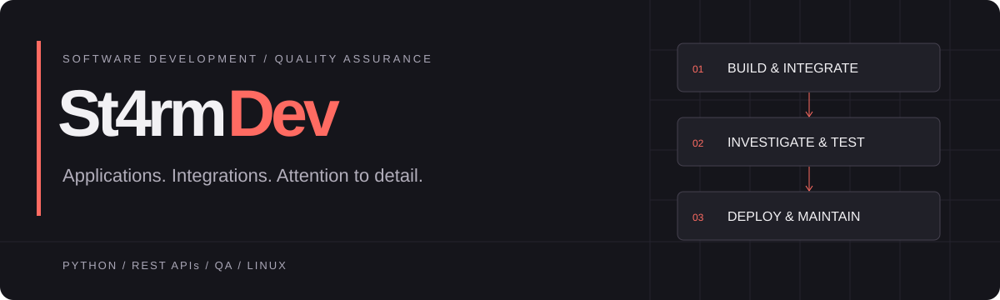

<a href="https://st4rmdev.github.io/Portfolio/"><strong>EXPLORE THE PORTFOLIO ↗</strong></a> &nbsp; · &nbsp; <a href="https://github.com/St4rmDev/Portfolio/tree/main/manual_testing">Manual QA samples</a> &nbsp; · &nbsp; <a href="https://github.com/St4rmDev/Portfolio/tree/main/automated_testing">API automation</a>

## Software, from implementation to release.

I build and test mobile and desktop applications, API-connected tools and automation. My work spans integration, debugging, hands-on QA and deployment on Linux VPS.

| QA in practice | Software delivery |
| :--- | :--- |
| **50+** functional, exploratory and localization test cycles | Mobile and desktop application projects |
| **100+** defects documented with reproducible details | Python automation, REST APIs and Telegram workflows |
| **10+** mobile device models; **200+** defects logged | Project systems with **5,000+** recorded user interactions |

## What I work with

| Testing | Development & systems |
| :--- | :--- |
| Functional · Exploratory · Regression · Localization | Python · REST APIs · SQL · Git |
| Mobile · API · Defect reporting · Retesting | Linux VPS · Deployment · Migration · Monitoring |
| Jira · Postman · Charles Proxy · DevTools · pytest | Application integration · Telegram Bot API |

## Background

**Certificates** — Google Cybersecurity Professional Certificate (2024) · AWS Cloud Technology Consultant Professional Certificate (2024) · Cisco Networking Basics (2023)

**German exams** — Goethe-Zertifikat A2 (2026) · ÖSD Zertifikat B1 (2026)

**Languages** — Turkish (native) · English (C1) · Russian (B1, certified) · Polish (A2) · **German (B1)**
